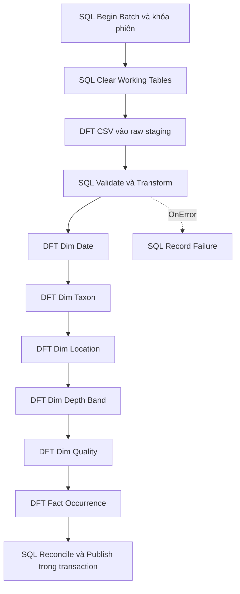

# Marine Shift Range SSIS

Hoàn thiện phần tích hợp dữ liệu cho đồ án **Phân tích sự thay đổi phạm vi phân bố của các loài sinh vật biển tại Biển Đông trong bối cảnh biến đổi khí hậu bằng OLAP**.

Package SSIS thật đã chạy trên SQL Server 2025 Standard Developer Edition, nạp **108.680 bản ghi**, **0 reject**, build Visual Studio thành công và tạo file triển khai `.ispac`.

| Bảng | Số dòng đã kiểm chứng |
|---|---:|
| Dim_Date | 2.314 |
| Dim_Taxon | 7.737 |
| Dim_Location | 3.067 |
| Dim_Depth_Band | 5 |
| Dim_Quality | 26 |
| Fact_Occurrence | 108.680 |

## Chạy ETL

Yêu cầu: Windows, SQL Server 2025 có Integration Services runtime, Microsoft OLE DB Driver for SQL Server (`MSOLEDBSQL`), `sqlcmd`, Windows Authentication. Để mở/build project, dùng Visual Studio có extension SQL Server Integration Services Projects hỗ trợ target SQL Server 2025. Máy đã kiểm chứng sử dụng Visual Studio 18.10.3.

Mở PowerShell tại thư mục repository:

```powershell
.\scripts\initialize.ps1 -ServerName '.' -DatabaseName 'MARINE_SHIFT_RANGE_DW'
.\scripts\run-etl.ps1 -ServerName '.' -DatabaseName 'MARINE_SHIFT_RANGE_DW'
sqlcmd -S . -E -d MARINE_SHIFT_RANGE_DW -b -f 65001 -i .\sql\04_verify.sql
```

Không cần Python để chạy package đã tạo. Với server khác hoặc file khác:

```powershell
.\scripts\initialize.ps1 -ServerName 'MAYCUABAN\INSTANCE'
.\scripts\run-etl.ps1 -ServerName 'MAYCUABAN\INSTANCE' -DataFile 'D:\OLAP\occurrence_clean.csv'
```

`04_verify.sql` chứa các kỳ vọng của **file được cung cấp**; thay đổi nguồn cần cập nhật số liệu đối soát tương ứng. ETL hỗ trợ file theo cùng schema, còn kiểm tra số dòng cố định không áp dụng cho một dataset mới.

## Mở trong Visual Studio

1. Mở `ssis/MARINE_SHIFT_RANGE_SSIS.sln` hoặc `.slnx`.
2. Mở `Package.dtsx`, chọn tab Control Flow để xem 11 task và 10 success constraints.
3. Mở cửa sổ Variables, đặt `User::ServerName`, `User::DatabaseName`, `User::DataFile` (đường dẫn tuyệt đối), `User::MaxRejects=0`.
4. Khởi tạo database bằng script trên rồi chạy Start. Mở từng Data Flow để xem Flat File Source/OLE DB Source và OLE DB Destination cùng column mappings.
5. Build configuration Development để tạo `ssis/bin/Development/MARINE_SHIFT_RANGE_SSIS.ispac`.

`MARINE_SHIFT_RANGE_SSIS.ispac` ở thư mục gốc là bản build đã kiểm chứng. Deploy bằng Integration Services Deployment Wizard nếu đã cấu hình SSISDB; đặt các biến package cho máy chạy trong Visual Studio trước khi build bản deploy. Luồng file qua `run-etl.ps1` là cách chạy đã được kiểm thử trực tiếp; repo không tự tạo SSISDB hoặc job SQL Agent.

## Luồng xử lý



Các phép biến đổi nằm trong SQL views và stored procedures; SSIS điều phối và thực hiện 7 Data Flow. Đây là thiết kế ELT có staging, không sử dụng Script Task hoặc Python để giả lập việc nạp SSIS. Khóa fact được giải bằng join SQL với 5 bảng chiều `load`, sau đó SSIS nạp kết quả vào `load.Fact_Occurrence`.

`etl` chứa staging, batches, rejects và taxonomy conflicts. `load` chứa kết quả đang chuẩn bị. Chỉ sau kiểm tra số dòng và khóa ngoại, `usp_Publish` thay nội dung 6 bảng `dbo` trong một transaction. Chạy lại cùng file cho cùng hash nội dung của cả 6 bảng. Mặc định một reject cũng làm package fail và giữ nguyên kho đã publish. Nguồn phải là **snapshot đầy đủ**; không dùng pipeline này để append một file delta. ID các chiều taxon/location/quality được tạo lại cho từng snapshot và không dùng làm khóa ổn định bên ngoài kho.

Kho dành riêng: `MARINE_SHIFT_RANGE_DW`. Database `MARINE_SHIFT_RANGE` ban đầu là Management Data Warehouse của Data Collector; không cần Data Collector để xây kho OLAP nghiệp vụ.

## Kiểm chứng và nội dung báo cáo

- `docs/CHUONG_2_SSIS.md`: nội dung chương 2, quy tắc chuyển đổi và hướng dẫn thao tác.
- `docs/CHUONG_2_SSIS.pdf`: bản trình bày chương SSIS, sơ đồ và kết quả chạy thật.
- `evidence/warehouse-validation.json`: số dòng, mẫu dữ liệu, hash SHA-256 và nhật ký batch.
- `evidence/integration-tests.json`: chạy lại giống hệt, thử CSV lỗi, giữ nguyên kho khi lỗi.
- `evidence/final-run.log`, `evidence/sql-validation.txt`, `evidence/visual-studio-build.log`: bằng chứng chạy và build.

```powershell
# Kiểm thử thật trên SQL Server; mất khoảng 2 phút với bộ dữ liệu này
.\tests\integration.ps1
# Kiểm tra schema và fingerprint nguồn, không cần SQL Server
python -m unittest discover -s tests -p 'test_*.py' -v
# Tái sinh SQL và package từ mã nguồn (cần SSIS SDK 2025)
python .\scripts\build_sql.py
.\scripts\build-package.ps1
```

GitHub Actions chỉ chạy kiểm tra dữ liệu/XML/ISPAC và tính nhất quán SQL; nó không chạy SSIS trong Linux. Kiểm thử runtime đã thực hiện trực tiếp trên Windows và SQL Server của đồ án.

## Các điểm cần sửa trong báo cáo hiện tại

`Dim_Quality` có **26** nhóm khi giữ cả flags và occurrence status; 17 không khớp dữ liệu thực tế. `Dim_Taxon` giữ `species` theo sơ đồ hình sao. Mười tên khoa học có nhiều bộ phân loại: chọn bộ đầy đủ nhất, rồi tần suất lớn nhất, rồi thứ tự xuất hiện; tất cả phương án gốc được lưu ở `etl.TaxonConflict`, chưa phải kết luận phân loại đã được chuyên gia xác minh. Độ sâu chia nửa kín `[0,50)`, `[50,200)`, `[200,1000)`, `[1000,+∞)`; tên nhóm cuối được sửa thành `>=1000 m` cho đúng biên.

SST/SSS được giữ theo ngữ cảnh vị trí của dữ liệu gốc. File hiện tại không chứng minh SST là số đo ở ngày quan sát và không đủ để kết luận quan hệ nhân quả với biến đổi khí hậu. Phân tích dịch chuyển nên phân biệt số bản ghi và số cá thể, lọc chất lượng khi cần, và không tự đổi trạng thái thiếu thành `present`.

Chi tiết nguồn và phạm vi: [data/README.md](data/README.md).
